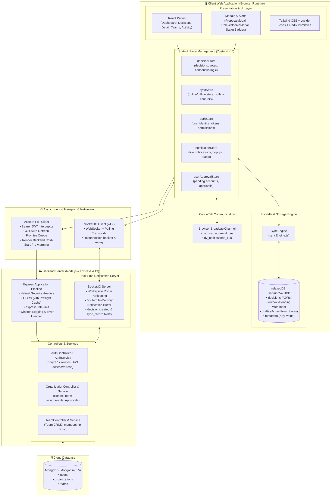
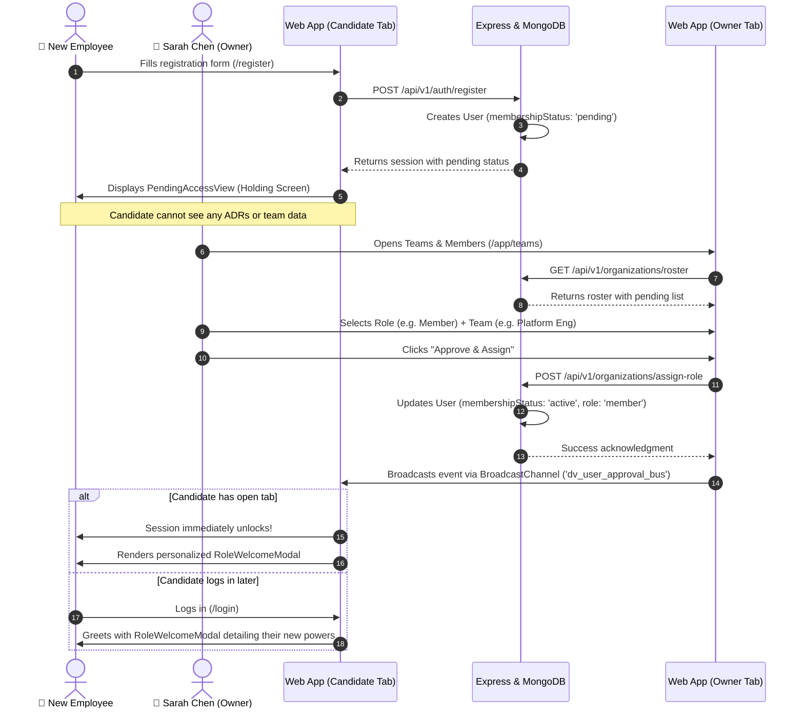

# 🏛️ DecisionVault

> **Local-First Collaborative Architectural Decision Management Platform**  
> *Never lose the "why" behind critical engineering and product decisions again.*

[](https://www.typescriptlang.org/)
[](https://react.dev/)
[](https://nodejs.org/)
[](https://expressjs.com/)
[](https://www.mongodb.com/)
[](https://dexie.org/)
[](https://socket.io/)
[](https://tailwindcss.com/)
[](https://opensource.org/licenses/MIT)

---

## 📑 Table of Contents

1. [🌟 The Executive & Non-Technical Guide](#1-the-executive--non-technical-guide)
   - [What is This Project in Plain English?](#what-is-this-project-in-plain-english)
   - [The Real-World Problem: "Architectural Amnesia"](#the-real-world-problem-architectural-amnesia)
   - [Everyday Analogies Anyone Can Grasp](#everyday-analogies-anyone-can-grasp)
   - [Non-Technical Glossary](#non-technical-glossary)
   - [Who Uses It? (User Personas & Stories)](#who-uses-it-user-personas--stories)
   - [A Step-by-Step Story of a Decision in Action](#a-step-by-step-story-of-a-decision-in-action)
2. [🖥️ Complete User Interface & Feature Tour](#2-complete-user-interface--feature-tour)
   - [Public & Authentication Experiences](#public--authentication-experiences)
   - [Workspace Dashboard](#workspace-dashboard)
   - [Decisions Explorer & Instant Command Palette (⌘K)](#decisions-explorer--instant-command-palette-k)
   - [The ADR Authoring Studio & Auto-Draft Engine](#the-adr-authoring-studio--auto-draft-engine)
   - [Decision Detail & Real-Time Democratic Voting Widget](#decision-detail--real-time-democratic-voting-widget)
   - [Teams, Members & The Owner Approval Center](#teams-members--the-owner-approval-center)
   - [Audit Trail & Activity Log](#audit-trail--activity-log)
   - [Workspace Settings & Adaptive Theme Engine](#workspace-settings--adaptive-theme-engine)
3. [🏗️ Deep-Dive Engineering Architecture](#3-deep-dive-engineering-architecture)
   - [System Blueprint (Full Diagram)](#system-blueprint-full-diagram)
   - [Local-First Architecture & Outbox Engine](#local-first-architecture--outbox-engine)
   - [Democratic Majority Consensus Algorithm](#democratic-majority-consensus-algorithm)
   - [Real-Time WebSocket & Cross-Tab Bus](#real-time-websocket--cross-tab-bus)
   - [Security Architecture, JWT Rotation & Cloud Pre-Warming](#security-architecture-jwt-rotation--cloud-pre-warming)
4. [🔒 Role-Based Access Control (RBAC) Specification](#4-role-based-access-control-rbac-specification)
   - [Permissions Matrix](#permissions-matrix)
   - [The New User Onboarding & Approval Lifecycle](#the-new-user-onboarding--approval-lifecycle)
5. [💾 Data Models & Storage Schemas](#5-data-models--storage-schemas)
   - [Client-Side IndexedDB Tables (Dexie.js)](#client-side-indexeddb-tables-dexiejs)
   - [Server-Side MongoDB Schemas (Mongoose)](#server-side-mongodb-schemas-mongoose)
6. [🔌 Complete REST API & WebSocket Protocol Reference](#6-complete-rest-api--websocket-protocol-reference)
   - [Authentication Endpoints](#authentication-endpoints)
   - [Organization & Team Endpoints](#organization--team-endpoints)
   - [WebSocket Event Flows](#websocket-event-flows)
7. [💻 Quick Start & Step-by-Step Local Setup](#7-quick-start--step-by-step-local-setup)
   - [System Prerequisites](#system-prerequisites)
   - [Installation Commands](#installation-commands)
   - [Pre-Seeded Demo Accounts](#pre-seeded-demo-accounts)
8. [🚀 Production Deployment Guide](#8-production-deployment-guide)
9. [📂 Comprehensive File Directory Tour](#9-comprehensive-file-directory-tour)
10. [❓ Frequently Asked Questions (FAQ) & Troubleshooting](#10-frequently-asked-questions-faq--troubleshooting)

---

# 1. 🌟 The Executive & Non-Technical Guide

### What is This Project in Plain English?

**DecisionVault** is a collaborative digital logbook for engineering and product teams. It is a specialized system that records, evaluates, and preserves **every major technical decision** made in an organization, along with **why** it was made, **who** voted for or against it, and **what alternatives** were rejected.

Furthermore, it is **"Local-First"**, meaning it works **instantly with 0ms waiting time**, functions completely offline (such as on an airplane or subway without internet), and automatically synchronizes seamlessly across all team members when internet access returns.

---

### The Real-World Problem: "Architectural Amnesia"

Every software company experiences this scenario:
1. **The Choice**: In 2024, an engineering team decides to store customer passwords in a particular format, or chooses Database A instead of Database B because of a very specific operational limitation.
2. **The Lost Context**: The rationale was discussed in a Slack message, a casual hallway chat, or an unrecorded meeting. It was never formally documented.
3. **The Departure**: A year later, those engineers leave for other opportunities.
4. **The Disaster**: A new developer arrives, encounters the code, thinks *"Why on earth did they do this strange thing? I can do it better!"*, deletes it, and deploys a "fix" that immediately crashes company servers.

This phenomenon is called **Architectural Amnesia**, and it costs businesses millions of dollars in wasted engineering hours, duplicated effort, and catastrophic outages.

**DecisionVault cures Architectural Amnesia permanently.**

---

### Everyday Analogies Anyone Can Grasp

To understand how DecisionVault works under the hood, consider these three everyday comparisons:

#### 1. The Skyscraper Blueprints Analogy (Why ADRs Exist)
When constructing a 60-story skyscraper, plumbers and electricians are not permitted to randomly drill holes through steel support pillars based on verbal chats. Every deviation requires a signed **change order**:
- *What is the problem?*
- *What alternative paths exist?*
- *Who approved the change?*
- *What are the safety trade-offs?*

Ten years later, when maintenance is performed, technicians inspect that official change order. **DecisionVault is that master architectural logbook for software systems.**

#### 2. The Flight Black Box Analogy (Why Accountability Matters)
Airplanes carry flight data recorders ("black boxes") so that in any circumstance, investigators have an unalterable, chronological record of every pilot action, instrument reading, and decision made in the cockpit. 
DecisionVault provides an unalterable **Activity Audit Trail**: whenever a decision is proposed, revised, voted on, accepted, or retired, the team has complete visibility.

#### 3. The Postal Outbox Analogy (How "Local-First" Works)
Imagine you are writing a letter on an airplane. You do not need to wait until you land to write your letter. You write it, seal it, and place it in your bag's **outbox compartment**. The second your flight lands and you see a mailbox, you drop it in.
DecisionVault does the exact same thing in your web browser: when you make an edit offline, it stores your work safely inside your computer's built-in database (**IndexedDB Outbox**). As soon as your internet returns, DecisionVault automatically delivers all pending changes to the cloud.

---

### Non-Technical Glossary

| Term | What it Means in Simple Language |
| :--- | :--- |
| **ADR (Architecture Decision Record)** | A structured document that captures a key technical choice, the problem it solves, its consequences, and its trade-offs. |
| **Local-First** | Software that stores its data on your personal computer first, making it blazingly fast and functional without internet, while syncing in the background. |
| **IndexedDB** | A robust database that lives directly inside your web browser (Chrome, Safari, Edge, Firefox), allowing web pages to store massive amounts of data offline. |
| **Outbox** | A temporary holding area where offline actions are queued up until an internet connection is established to send them to the server. |
| **Consensus Voting** | A democratic team evaluation where engineers vote Up or Down on a proposal. When majority support is reached, the decision is officially accepted. |
| **RBAC (Role-Based Access Control)** | A security system that restricts actions based on your job title (e.g., an Owner can approve new accounts, while a Stakeholder can only read). |
| **WebSocket / Socket.IO** | A permanent two-way telephone line between the browser and the server that enables instant, real-time alerts without refreshing the web page. |
| **JWT (JSON Web Token)** | A secure, tamper-proof digital passport that proves who you are on every click without asking for your password repeatedly. |

---

### Who Uses It? (User Personas & Stories)

```
+---------------------------------------------------------------------------------------------------------+
|                                        DECISIONVAULT USER PERSONAS                                      |
+---------------------------------------------------------------------------------------------------------+
|  👑 Sarah Chen — Lead Architect & Organization Owner                                                    |
|  • "I need to ensure our teams adhere to engineering standards and that proposals receive formal       |
|    peer review. I also need to guard who enters our workspace."                                         |
|  • Her Workflow: Reviews pending employee accounts, assigns roles, and posts high-priority proposals    |
|    that automatically trigger workspace-wide review dialogs.                                           |
+---------------------------------------------------------------------------------------------------------+
|  ⚡ Alex Rivera — Senior Full-Stack Engineer                                                             |
|  • "I travel frequently and code on trains, flights, and cafes with spotty Wi-Fi. I cannot tolerate    |
|    apps that freeze when an API call times out."                                                        |
|  • His Workflow: Writes ADRs offline with 0ms lag, casts consensus votes, and lets the local sync       |
|    engine flush everything to the server the moment Wi-Fi reconnects.                                   |
+---------------------------------------------------------------------------------------------------------+
|  👁️ Jordan Lee — Product Manager & Stakeholder                                                          |
|  • "I need to know why engineers chose a particular technology and how it affects our product delivery  |
|    timeline, but I shouldn't be altering technical specs."                                              |
|  • Her Workflow: Enjoys read-only transparency. Searches the entire vault using ⌘K, reads decisions,   |
|    and reviews voter rationale while protected from accidental edits.                                   |
+---------------------------------------------------------------------------------------------------------+
```

---

### A Step-by-Step Story of a Decision in Action

To understand the end-to-end lifecycle, follow this journey:

1. **The Idea**: Alex, a senior engineer, notices the team's cloud bill is skyrocketing due to repetitive database queries. He wants to introduce an in-memory caching system (Redis).
2. **The Draft (Offline)**: On a flight without Wi-Fi, Alex opens DecisionVault. Because of its Local-First architecture, the app loads immediately. He types the proposal into the **Create Decision** studio. The app automatically autosaves every keystroke into his browser's local IndexedDB vault.
3. **The Submission & Outbox**: Alex clicks **"Submit for Review"**. Because he is offline, DecisionVault assigns it a local number, marks it as `proposed`, and safely queues it in the **Local Outbox**.
4. **The Automatic Sync**: Alex lands and connects to airport Wi-Fi. The browser detects network connectivity, and the `SyncEngine` instantly transmits the outbox payload to the cloud server, marking the decision as `synced`.
5. **The Real-Time Team Alert**: Instantly, across the country, Sarah (the Lead Architect) and the engineering team see a live notification appear in their workspace header.
6. **Democratic Peer Voting**: Teammates open the decision. They read the context, alternatives, and trade-offs. Engineers cast their votes:
   - Alex votes **Up** (Author endorsement).
   - Sarah votes **Up** (Approved from an architectural standpoint).
   - Another engineer questions memory usage and votes **Down**.
7. **Consensus Auto-Alignment**: With 2 Upvotes and 1 Downvote, the majority threshold is satisfied. DecisionVault's state machine automatically transitions the decision from `proposed` to `accepted`.
8. **Permanent Institutional Memory**: Two years later, when a new developer asks *"Why are we running Redis?"*, they press `⌘K`, type "Redis", and immediately read the exact rationale, voter breakdown, and alternative databases considered.

---

# 2. 🖥️ Complete User Interface & Feature Tour

### Public & Authentication Experiences
- **Landing Page (`/`)**: A clean hero layout introducing DecisionVault's core value pillars: Access Governance, Offline-First Sync, and Democratic Consensus. Features a header theme switcher and quick sign-in triggers.
- **Registration (`/register`)**: New users enter their name, email, and password. Upon submission, accounts are registered with `membershipStatus: 'pending'`, preventing unauthorized access until approved by an administrator.
- **Login (`/login`)**: Supports standard authentication and includes **1-click demo role switcher buttons** allowing reviewers to instantly test as **Owner (Sarah)**, **Member (Alex)**, or **Viewer (Jordan)**.
- **Holding View (`PendingAccessView`)**: When a newly registered user logs in before approval, they are presented with a secure, polite waiting screen that explains their account is awaiting role assignment from the Organization Owner.

### Workspace Dashboard (`/app/dashboard`)
- **Status Filter Metric Cards**: Live interactive tally cards displaying **Total**, **Accepted**, **Proposed**, **Draft**, and **Deprecated** decisions. Clicking any card instantly filters the table below.
- **Owner Action Alert Banner**: When pending employee registrations are awaiting review, the Owner sees a prominent amber warning card linking directly to the approval center.
- **Owner Proposal Dialogue & Banner**: When an Owner submits a high-priority architectural decision, team members are greeted with a customized review card highlighting the author, team, and proposal excerpt.
- **Recent Decisions Directory**: Displays human-readable decision numbers (`ADR-001`, `ADR-002`), title, team badge, author attribution, and status badges.

### Decisions Explorer & Instant Command Palette (`⌘K`)
- **Faceted Filtering**: Filter decisions by lifecycle status (`all`, `proposed`, `accepted`, `deprecated`, `draft`) and functional engineering team (`Platform Engineering`, `Product & Design`, etc.).
- **Multi-Angle Sorting**: Sort by Newest Updated, Oldest, or Total Endorsement Votes.
- **Global Command Palette (`⌘K` / `Ctrl+K`)**: Accessible from any screen via keyboard shortcut, offering sub-300ms fuzzy search across titles, decisions, contexts, tags, and author names.

### The ADR Authoring Studio & Auto-Draft Engine (`/app/decisions/new`)
- **Standardized ADR Structure**: Form fields enforce engineering best practices:
  1. **Title**: Concise summary of the decision.
  2. **Team**: Assignable functional division.
  3. **Context**: Why is this decision necessary? What business problem are we solving?
  4. **The Decision**: What is the chosen solution and how will it be executed?
  5. **Consequences & Trade-Offs**: What are the positive and negative side effects?
  6. **Alternatives Considered**: What other options were evaluated and why were they rejected?
- **Intelligent Draft Recovery**: Drafts are continuously autosaved to IndexedDB. If an engineer accidentally refreshes or navigates away, the form automatically restores their in-progress work upon return.
- **Status Guardrails**: New decisions can only be submitted as `draft` or `proposed`. They cannot be initialized as `accepted` without peer voting.

### Decision Detail & Real-Time Democratic Voting Widget (`/app/decisions/:id`)
- **ADR Metadata Header**: Features human-friendly numbering (`ADR-003`), status badges, last updated date, and a 1-click **Share Link** button.
- **Consensus Voting Control**:
  - Interactive **Endorse (Upvote)** and **Oppose (Downvote)** buttons.
  - Clicking your active stance toggles it off; clicking the opposite stance cleanly switches your vote.
  - Viewers/Stakeholders see an informative disabled state explaining that voting is restricted to engineering members.
- **Transparent Voter Audit Table**: Lists every voter, their role title, email, exact timestamp, and stance. Allows filtering by "All", "Endorsers", or "Opponents".
- **Dynamic Consensus Alignment**: Real-time evaluation of majority consensus. When Upvotes exceed Downvotes, status becomes `accepted`. If Downvotes prevail, status automatically transitions to `deprecated`.

### Teams, Members & The Owner Approval Center (`/app/teams`)
- **Three Specialized Views**:
  1. **Grouped View**: Visual cards organized by team, showing member counts, team descriptions, and nested member profiles.
  2. **Directory Table**: Comprehensive tabular list of all workspace members with email, status, and role badges.
  3. **Role Hierarchy**: An educational breakdown explaining what Owner, Admin, Member, and Viewer roles can do.
- **Owner Approval Center**:
  - Displays pending user registrations with name, email, and registration time.
  - Allows the Owner to select an assigned role (`Member`, `Admin`, `Viewer`) and target team from inline dropdowns.
  - Approving a user triggers an instant multi-tab broadcast via `BroadcastChannel` and unlocks their session in real-time.
- **Member Management**: Allows editing existing members' roles or removing users from the organization.

### Audit Trail & Activity Log (`/app/activity`)
- Chronological, searchable timeline of all activity across the organization.
- Tracks proposal creation, consensus status shifts, team adjustments, and peer comments.
- Color-coded icons clearly distinguish between approvals, creations, and updates.

### Workspace Settings & Adaptive Theme Engine (`/app/settings`)
- **Profile Configuration**: View and update user display name, email, and active role.
- **Organization Settings**: For Owners/Admins, allows editing organization name, slug, and team structures.
- **Local Vault Diagnostics**: Displays live storage statistics: total stored decisions, pending outbox mutations, and active local drafts. Includes a 1-click "Vault Reseed / Reset" tool for testing.
- **Dual Theme Engine**: Seamlessly switch between light and dark modes with persistent local storage saving.

---

# 3. 🏗️ Deep-Dive Engineering Architecture

### System Blueprint (Full Diagram)

The following diagram illustrates the complete software architecture, from browser runtime to cloud persistence:



---

### Local-First Architecture & Outbox Engine

DecisionVault achieves zero-latency user interaction and offline capability using the **Outbox Pattern** implemented in `client/src/services/syncEngine.ts`.

#### The Outbox Data Flow
1. **Action Execution**: When a user creates a decision or votes, the client does not wait for a server response.
2. **Immediate Local Mutation**: The change is written directly to the Zustand memory store and the IndexedDB `decisions` table.
3. **Queueing in Outbox**: An `OutboxItem` is created:
   ```typescript
   interface OutboxItem {
     id: string;               // e.g. "outbox-1732261950-k3f9a"
     type: 'create_decision' | 'update_status' | 'vote_decision' | 'save_draft';
     payload: any;             // Operation parameters
     createdAt: string;        // ISO 8601 timestamp
     attempts: number;         // Retry count
     status: 'pending' | 'syncing' | 'synced' | 'failed';
   }
   ```
4. **Network Detection & Simulated Offline**:
   - The engine monitors physical browser events (`window.addEventListener('online')` and `'offline'`).
   - It also features an explicit **Simulated Offline Mode** via the UI sync button, allowing engineers to test offline performance even while connected to Wi-Fi.
5. **Flushing the Outbox (`processOutbox()`)**:
   - The engine retrieves pending items from Dexie in chronological order: `db.outbox.orderBy('createdAt').toArray()`.
   - Iterates through items with non-blocking async execution.
   - Updates the corresponding IndexedDB record with `synced: true`.
   - Atomically deletes the item from `db.outbox` upon acknowledgment.
   - Updates `pendingCount` and `lastSyncedAt` in the UI.

---

### Democratic Majority Consensus Algorithm

Architecture decisions in DecisionVault are governed by democratic consensus rather than unilateral decree. The voting mechanism in `client/src/store/decisionStore.ts` enforces the following algorithmic rules:

```typescript
// 1. Check Role Eligibility
const isViewerRole = voterRole === 'viewer' || voterRole.toLowerCase().includes('viewer');
if (isViewerRole) {
  console.warn('Stakeholders/Viewers have read-only access and cannot vote.');
  return;
}

// 2. Compute Voter Array Mutation
if (existingVoterIndex >= 0) {
  if (existingVoter.option === clickedType) {
    // Toggling the same option removes the vote
    newVoters = voters.filter((_, idx) => idx !== existingVoterIndex);
  } else {
    // Switching stance from 'up' to 'down' or vice-versa
    newVoters[existingVoterIndex] = { ...existingVoter, option: clickedType, votedAt: new Date().toISOString() };
  }
} else {
  // Brand new vote cast
  newVoters.push({ userId, userName, userEmail, userRole, option: clickedType, votedAt: new Date().toISOString() });
}

// 3. Dynamic Consensus Alignment
const upCount = newVoters.filter(v => v.option === 'up').length;
const downCount = newVoters.filter(v => v.option === 'down').length;

let newStatus = decision.status;
if (upCount > downCount) {
  newStatus = 'accepted';      // Majority endorsed
} else if (downCount > upCount) {
  newStatus = 'deprecated';    // Majority opposed
} else if (decision.status === 'accepted' || decision.status === 'deprecated') {
  newStatus = 'proposed';      // Deadlock / tie returns to review
}
```

---

### Real-Time WebSocket & Cross-Tab Bus

DecisionVault coordinates multi-user updates through a two-tiered real-time messaging pipeline:

#### 1. Browser `BroadcastChannel` (Cross-Tab Synchronization)
When an administrator operates across multiple browser tabs (e.g., approving an employee in Tab 1 while viewing ADRs in Tab 2):
- Channels `dv_user_approval_bus` and `dv_notifications_bus` publish events locally across all open tabs within the same origin.
- The other tabs immediately receive the message, update their stores, and refresh the UI without requiring an HTTP roundtrip.

#### 2. Socket.IO Real-Time Engine (Cross-Client Synchronization)
- **Room Subscriptions**: Upon logging in, clients join a room corresponding to their organization: `socket.emit('join_workspace', 'acme-corp')`.
- **Broadcast on Creation**: When an author submits an ADR, `socketService.broadcastNewDecision(record)` sends `decision:created` to the server.
- **Server Dispatch**: The server broadcasts two events to all other connected peers:
  1. `notification:new_decision`: Triggers floating toast notifications and increments the unread notification badge.
  2. `decision:sync_record`: Delivers the full ADR payload directly into peers' local databases so it appears instantly in their feeds.
- **Reconnection History Buffer**: The server maintains an in-memory buffer of the last 50 workspace notifications. When a user reconnects after being offline, `request_recent_notifications` replays any missed notices.

---

### Security Architecture, JWT Rotation & Cloud Pre-Warming

#### 1. Authentication & Token Lifecycle
- **Access Tokens**: Short-lived JSON Web Tokens (15-minute expiration) carrying user ID, organization ID, and role. Transmitted via the `Authorization: Bearer <token>` header.
- **Refresh Tokens**: Cryptographically secure, long-lived (7-day expiration) random strings stored in an `httpOnly` secure cookie and persisted as SHA-256 hashes inside MongoDB.
- **Silent Refresh Interceptor**: If an API call fails with HTTP `401 Unauthorized`:
  - Axios halts outgoing requests and buffers them into a promise queue (`failedQueue`).
  - A single refresh call is made to `/api/v1/auth/refresh`.
  - Upon receiving a fresh access token, all buffered requests are replayed automatically with zero user interruption.

#### 2. Cloud Backend Pre-Warming (Render Cold-Start Defense)
Free-tier cloud containers (such as Render or Fly.io) spin down after periods of inactivity, resulting in 30-50 second cold-start delays.
DecisionVault implements proactive **pre-warming** in `client/src/services/api.ts`:
- As soon as the web application script loads in the user's browser, a lightweight, non-blocking `GET /health` ping is fired in the background.
- By the time the user finishes typing their credentials or navigating to the dashboard, the cloud container is warm and ready for sub-second responses.

---

# 4. 🔒 Role-Based Access Control (RBAC) Specification

DecisionVault features a strict 4-tier Role-Based Access Control matrix enforced both on the server (via `authorize.ts` middleware) and on the client (via `usePermissions.ts` and `RoleGuard.tsx`).

### Permissions Matrix

| Capability | 👑 Owner | 🛡️ Admin | ⚡ Member (Engineer) | 👁️ Viewer (Stakeholder) |
| :--- | :---: | :---: | :---: | :---: |
| **Browse Decisions & Search via ⌘K** | ✅ | ✅ | ✅ | ✅ |
| **Read Full ADR Context & Trade-Offs** | ✅ | ✅ | ✅ | ✅ |
| **Inspect Transparent Voter Breakdown** | ✅ | ✅ | ✅ | ✅ |
| **Access Activity Log & Audit Trail** | ✅ | ✅ | ✅ | ✅ |
| **Draft New Decisions (Local Autosave)** | ✅ | ✅ | ✅ | ❌ *(Read-only)* |
| **Submit Proposals for Team Review** | ✅ | ✅ | ✅ | ❌ *(Read-only)* |
| **Vote on Decisions (Up / Down)** | ✅ | ✅ | ✅ | ❌ *(Read-only)* |
| **Broadcast Workspace Review Dialogs** | ✅ *(Owner Priority)* | ❌ | ❌ | ❌ |
| **Review & Approve New User Signups** | ✅ | ✅ | ❌ | ❌ |
| **Assign Roles (Admin, Member, Viewer)** | ✅ | ❌ | ❌ | ❌ |
| **Assign Team Memberships** | ✅ | ✅ | ❌ | ❌ |
| **Edit Organization Profile & Slug** | ✅ | ✅ | ❌ | ❌ |

---

### The New User Onboarding & Approval Lifecycle

To protect proprietary architectural records, DecisionVault implements an administrative gate:



---

# 5. 💾 Data Models & Storage Schemas

### Client-Side IndexedDB Tables (Dexie.js)

Database Name: `DecisionVaultDB`

```typescript
// 1. Decisions Table (Indexed on: id, number, status, team, createdAt, updatedAt)
export interface DecisionRecord {
  id: string;               // Unique primary key (e.g. "dec-1732261945-a9b1c")
  number: number;           // Sequential integer (1, 2, 3...)
  title: string;            // Headline
  status: DecisionStatus;   // 'proposed' | 'accepted' | 'deprecated' | 'draft'
  team: string;             // Functional division (e.g. "Platform Engineering")
  tags: string[];           // Array of tags (e.g. ["Architecture", "Database"])
  context: string;          // Business problem & context
  decision: string;         // Detailed technical choice
  consequences: string;     // Trade-offs, risks, positive/negative outcomes
  alternatives?: string;    // Rejected options
  author: {
    id: string;
    name: string;
    email: string;
    role: string;
  };
  votes: {
    up: number;
    down: number;
    userVote?: 'up' | 'down';
    voters: VoterRecord[];  // Transparent voter audit records
  };
  synced?: boolean;         // Cloud acknowledgment flag
  createdAt: string;        // ISO 8601 string
  updatedAt: string;        // ISO 8601 string
}

// 2. Outbox Table (Indexed on: id, type, status, createdAt)
export interface OutboxItem {
  id: string;               // Unique operation ID (e.g. "outbox-1732261950-xyz")
  type: 'create_decision' | 'update_status' | 'vote_decision' | 'save_draft';
  payload: any;             // Operation parameters
  createdAt: string;        // ISO timestamp
  attempts: number;         // Execution retry counter
  status: 'pending' | 'syncing' | 'synced' | 'failed';
}

// 3. Drafts Table (Indexed on: id, updatedAt)
export interface LocalDraft {
  id: string;               // "new-decision-draft"
  title: string;
  team: string;
  status: string;
  tags: string[];
  context: string;
  decision: string;
  consequences: string;
  alternatives?: string;
  updatedAt: string;
}
```

---

### Server-Side MongoDB Schemas (Mongoose)

#### 1. User Model (`models/User.ts`)
```typescript
{
  name: { type: String, required: true, trim: true, minlength: 2, maxlength: 100 },
  email: { type: String, required: true, unique: true, lowercase: true, trim: true },
  password: { type: String, required: true, select: false }, // Hashed with bcrypt (12 rounds)
  avatar: { type: String },
  organizations: [{ type: Schema.Types.ObjectId, ref: 'Organization' }],
  refreshTokens: [{
    token: { type: String, required: true },                 // Hashed refresh token
    expiresAt: { type: Date, required: true },
    createdAt: { type: Date, default: Date.now }
  }],
  passwordResetToken: { type: String, select: false },
  passwordResetExpires: { type: Date, select: false }
}
```

#### 2. Organization Model (`models/Organization.ts`)
```typescript
{
  name: { type: String, required: true, trim: true },
  slug: { type: String, required: true, unique: true, lowercase: true },
  owner: { type: Schema.Types.ObjectId, ref: 'User', required: true },
  members: [{
    userId: { type: Schema.Types.ObjectId, ref: 'User', required: true },
    role: { type: String, enum: ['owner', 'admin', 'member', 'viewer'], default: 'viewer' },
    status: { type: String, enum: ['active', 'pending'], default: 'active' },
    joinedAt: { type: Date, default: Date.now }
  }]
}
```

#### 3. Team Model (`models/Team.ts`)
```typescript
{
  name: { type: String, required: true, trim: true },
  description: { type: String, trim: true },
  organizationId: { type: Schema.Types.ObjectId, ref: 'Organization', required: true },
  members: [{ type: Schema.Types.ObjectId, ref: 'User' }]
}
```

---

# 6. 🔌 Complete REST API & WebSocket Protocol Reference

All REST endpoints are versioned under `/api/v1`.

### Authentication Endpoints

| Method | Endpoint | Description | Headers / Auth | Payload Example |
| :--- | :--- | :--- | :---: | :--- |
| `POST` | `/api/v1/auth/register` | Create a new user account | None | `{ "name": "Devon", "email": "devon@example.com", "password": "Password123!" }` |
| `POST` | `/api/v1/auth/login` | Authenticate with credentials | None | `{ "email": "alex@decisionvault.io", "password": "Password123!" }` |
| `POST` | `/api/v1/auth/refresh` | Exchange refresh token for new access token | Cookie / Bearer | *Empty* |
| `POST` | `/api/v1/auth/logout` | Revoke active refresh token | Bearer Token | *Empty* |
| `GET` | `/api/v1/auth/me` | Fetch active user profile & role | Bearer Token | *Empty* |
| `POST` | `/api/v1/auth/forgot-password` | Request password reset email | None | `{ "email": "user@example.com" }` |
| `POST` | `/api/v1/auth/reset-password` | Reset password using token | None | `{ "token": "...", "newPassword": "..." }` |

### Organization & Team Endpoints

| Method | Endpoint | Description | Role Required | Payload Example |
| :--- | :--- | :--- | :---: | :--- |
| `GET` | `/api/v1/organizations/roster` | List all members and pending accounts | Member / Viewer | *Empty* |
| `POST` | `/api/v1/organizations/assign-role` | Approve a pending user with role & team | **Owner** | `{ "userId": "...", "role": "member", "team": "Platform Engineering" }` |
| `POST` | `/api/v1/organizations/reject-request` | Reject a pending registration | **Owner / Admin** | `{ "userId": "..." }` |
| `PUT` | `/api/v1/organizations/members/:userId` | Update an existing member's role/team | **Owner / Admin** | `{ "role": "admin", "team": "Core Architecture" }` |
| `DELETE` | `/api/v1/organizations/members/:userId` | Remove a member from organization | **Owner / Admin** | *Empty* |
| `GET` | `/api/v1/organizations/:orgId/teams` | List functional teams in organization | Member / Viewer | *Empty* |
| `POST` | `/api/v1/organizations/:orgId/teams` | Create a new team | **Admin / Owner** | `{ "name": "Security & Infra", "description": "..." }` |

### WebSocket Event Flows

```
Client (Browser)                                        Server (Socket.IO)
      │                                                         │
      │─── 1. socket.emit('join_workspace', orgSlug) ──────────>│ (Subscribes socket to room)
      │─── 2. socket.emit('request_recent_notifications') ────>│
      │<── 3. socket.emit('notifications:recent', [buffer]) ────│ (Replays missed notices)
      │                                                         │
      │─── 4. socket.emit('decision:created', record) ─────────>│ (Author publishes ADR)
      │                                                         │
      │                                                         │─── Broadcasts to room:
      │<── 5. socket.broadcast.emit('notification:new_decision')│ (Alerts connected peers)
      │<── 6. socket.broadcast.emit('decision:sync_record') ────│ (Delivers payload to DB)
```

---

# 7. 💻 Quick Start & Step-by-Step Local Setup

### System Prerequisites
- **Node.js**: `v18.0.0` or higher (`v20.x` LTS recommended).
- **npm**: `v9.0.0` or higher.
- **MongoDB**: A running local MongoDB instance (`mongodb://localhost:27017/decisionvault`) OR a cloud connection string from [MongoDB Atlas](https://www.mongodb.com/atlas).

### Installation Commands

1. **Clone the Repository**:
   ```bash
   git clone https://github.com/Adarsh048/DecisionVault.git
   cd DecisionVault
   ```

2. **Install All Monorepo Dependencies**:
   ```bash
   npm install
   ```

3. **Configure Server Environment Variables**:
   Create `server/.env` with the following configuration:
   ```env
   NODE_ENV=development
   PORT=5000
   MONGODB_URI=mongodb+srv://<username>:<password>@cluster0.mongodb.net/decisionvault?retryWrites=true&w=majority
   JWT_SECRET=decisionvault_jwt_secret_minimum_32_chars_long_dev
   JWT_EXPIRES_IN=15m
   REFRESH_TOKEN_SECRET=decisionvault_refresh_secret_min_32_chars_long_dev
   REFRESH_TOKEN_EXPIRES_IN=7d
   CLIENT_URL=http://localhost:5173
   BCRYPT_ROUNDS=12
   ```

4. **Configure Client Environment Variables**:
   Create `client/.env` with:
   ```env
   VITE_API_URL=/api/v1
   VITE_APP_NAME=DecisionVault
   ```

5. **Seed the Database with Demo Roles & Organizations**:
   ```bash
   npm run seed --workspace=server
   ```

6. **Start the Development Servers (Frontend + Backend concurrently)**:
   ```bash
   npm run dev
   ```
   - **Client Application**: [http://localhost:5173](http://localhost:5173)
   - **Backend API**: [http://localhost:5000](http://localhost:5000)
   - **Health Check**: [http://localhost:5000/api/v1/health](http://localhost:5000/api/v1/health)

---

### Pre-Seeded Demo Accounts

The database seed provides three ready-to-use user accounts representing each major organizational role:

| Persona | Role | Email | Password | Primary Testing Capabilities |
| :--- | :--- | :--- | :--- | :--- |
| **Sarah Chen** | 👑 `Owner` | `admin@decisionvault.io` | `Password123!` | Review pending users, assign roles/teams, propose owner decisions that trigger alerts. |
| **Alex Rivera** | ⚡ `Member` | `alex@decisionvault.io` | `Password123!` | Author ADRs, cast Up/Down votes, test offline mode & outbox sync. |
| **Jordan Lee** | 👁️ `Viewer` | `viewer@decisionvault.io` | `Password123!` | Experience read-only exploration, verify voting and proposal locks. |

---

# 8. 🚀 Production Deployment Guide

### Deploying the Frontend (Vercel)
The client includes a root-level `vercel.json` configured for SPA routing:
```json
{
  "buildCommand": "npm run build --workspace=client",
  "outputDirectory": "client/dist",
  "rewrites": [{ "source": "/(.*)", "destination": "/index.html" }]
}
```
1. Push your repository to GitHub.
2. Link the repository in the **Vercel Dashboard**.
3. Set Environment Variable: `VITE_API_URL=https://your-backend-api.onrender.com/api/v1`.
4. Deploy!

### Deploying the Backend (Render / Fly.io / Railway)
1. Create a new Web Service pointing to the root repository directory.
2. Configure Build Command: `npm install && npm run build --workspace=server`
3. Configure Start Command: `npm run start --workspace=server`
4. Set Production Environment Variables:
   - `NODE_ENV=production`
   - `PORT=5000`
   - `MONGODB_URI=<your-mongodb-atlas-production-uri>`
   - `JWT_SECRET=<strong-random-32-char-secret>`
   - `REFRESH_TOKEN_SECRET=<strong-random-32-char-secret>`
   - `CLIENT_URL=https://your-vercel-app.vercel.app`

---

# 9. 📂 Comprehensive File Directory Tour

```
DecisionVault/
│
├── client/                                  # Frontend Application (Vite + React 18 + TypeScript)
│   ├── src/
│   │   ├── components/                      # Reusable UI component library
│   │   │   ├── auth/PendingAccessView.tsx   # Holding screen for pending approval users
│   │   │   └── ui/                          # Modals (Proposal, RoleWelcome), StatusBadges, Logo
│   │   ├── hooks/                           # Custom React hooks
│   │   │   ├── useAuth.ts                   # Current authenticated session & credentials
│   │   │   └── usePermissions.ts            # Dynamic RBAC capability checks
│   │   ├── layouts/                         # Layout wrappers
│   │   │   ├── AppLayout.tsx                # Master authenticated layout (Sidebar, Header, Popovers)
│   │   │   ├── AuthLayout.tsx               # Centered card layout for Login / Register
│   │   │   └── PublicLayout.tsx             # Marketing and public pages wrapper
│   │   ├── lib/                             # Core library utilities
│   │   │   ├── db.ts                        # Dexie.js IndexedDB schema definition
│   │   │   └── constants.ts                 # System constants, colors, and role definitions
│   │   ├── pages/                           # Application screens
│   │   │   ├── app/                         # Protected views: Dashboard, Decisions, Detail, Teams, Activity
│   │   │   └── public/                      # Public views: Landing, Login, Register, Password Reset
│   │   ├── routes/                          # React Router definitions & AuthGuard protection
│   │   ├── services/                        # Infrastructure and networking services
│   │   │   ├── api.ts                       # Axios instance with 401 refresh queue & pre-warming
│   │   │   ├── syncEngine.ts                # Offline-first Outbox processor & network event listener
│   │   │   ├── socketService.ts             # Socket.IO client event handling & workspace relay
│   │   │   └── organizationService.ts       # Roster API calls and role assignments
│   │   ├── store/                           # Zustand persistent state stores
│   │   │   ├── decisionStore.ts             # ADR records, voting mutations, consensus auto-alignment
│   │   │   ├── syncStore.ts                 # Real-time sync status, offline toggle, storage stats
│   │   │   ├── notificationStore.ts         # In-app notifications, toasts, and dialog states
│   │   │   ├── userApprovalStore.ts         # User approval requests & cross-tab broadcast logic
│   │   │   └── authStore.ts                 # Authenticated user token and profile storage
│   │   └── types/                           # TypeScript interfaces and domain models
│   ├── package.json                         # Client dependencies and build scripts
│   └── vite.config.ts                       # Vite compiler, proxy configuration & path aliases
│
├── server/                                  # Backend API Server (Node.js + Express + TypeScript)
│   ├── src/
│   │   ├── config/                          # Environment loader, database connection & constants
│   │   ├── controllers/                     # HTTP route controllers (AuthController, OrgController)
│   │   ├── middleware/                      # Security headers, JWT authenticate, authorize, rateLimiter
│   │   ├── models/                          # Mongoose database models (User, Organization, Team)
│   │   ├── repositories/                    # Database query abstraction layer
│   │   ├── routes/                          # Express route definitions
│   │   ├── scripts/seed.ts                  # Database demo population script
│   │   ├── services/                        # Business logic execution (AuthService, OrgService)
│   │   ├── utils/                           # Winston logger, AppError, Token signing utilities
│   │   ├── validators/                      # Zod schema validation rules
│   │   ├── app.ts                           # Express app factory with security and middleware chain
│   │   └── server.ts                        # HTTP bootstrap & Socket.IO real-time server
│   ├── package.json                         # Server dependencies and scripts
│   └── tsconfig.json                        # Backend TypeScript configuration
│
├── package.json                             # Monorepo root configuration & unified dev scripts
├── vercel.json                              # Vercel deployment and routing rules
└── README.md                                # Master project documentation
```

---

# 10. ❓ Frequently Asked Questions (FAQ) & Troubleshooting

### Frequently Asked Questions

#### Q1: What makes DecisionVault different from Confluence, Notion, or Google Docs?
- **Structure**: Confluence and Google Docs are unstructured blank canvases where documents go to die and become obsolete. DecisionVault enforces the rigorous ADR format: Problem $\to$ Alternatives $\to$ Decision $\to$ Consequences.
- **Democratic Consensus**: Confluence has no concept of cryptographic peer voting, voter attribution, or automatic majority consensus transitions.
- **Local-First Speed**: Confluence takes seconds to load; DecisionVault loads in **0 milliseconds** directly from your local browser database and works completely offline.

#### Q2: What happens if two engineers vote or edit while offline?
DecisionVault uses an **atomic outbox sequence**. Each vote contains the voter's unique ID and timestamp. When both engineers reconnect, the server processes votes in FIFO (First-In, First-Out) order. Because votes are deduplicated by `userId`, every engineer's stance is accurately recorded without collision.

#### Q3: How do I test the offline functionality?
You don't need to turn off your Wi-Fi! Simply click the **"Vault Synced"** badge in the top navigation bar. It toggles into **"Offline · Local Vault"** (Simulated Offline Mode). You can create decisions and cast votes; notice how the counter increments (e.g., `1 pending change`). Click the badge again to go online and watch the outbox flush seamlessly to the server.

---

### Troubleshooting Common Issues

| Symptom | Cause | Solution |
| :--- | :--- | :--- |
| **Port 5000 or 5173 already in use** | A previous instance of the server or client is still running in the background. | Run `npx kill-port 5000 5173` or terminate the process in Task Manager, then re-run `npm run dev`. |
| **MongoDB connection timeout during `seed` or startup** | Local IP address not whitelisted in MongoDB Atlas, or DNS resolution failure. | In MongoDB Atlas, go to **Network Access** $\to$ click **Add IP Address** $\to$ choose **Allow Access From Anywhere (`0.0.0.0/0`)** for development. |
| **New user account is stuck on "Awaiting Role Assignment"** | The account has `status: 'pending'` by design to prevent unauthorized access. | Log in with the Owner account (`admin@decisionvault.io` / `Password123!`), open **Teams & Members**, and click **Approve & Assign**. |
| **Stale local data or unexpected UI state** | Browser IndexedDB cache retains old test records. | Navigate to **Settings** $\to$ click **"Reset & Reseed Local Vault"**, or open DevTools $\to$ Application $\to$ Clear Storage $\to$ Clear site data. |

---

<p align="center">
  <b>DecisionVault</b> — Preserving Institutional Intelligence.<br/>
  Distributed under the <a href="https://opensource.org/licenses/MIT">MIT License</a>.
</p>
