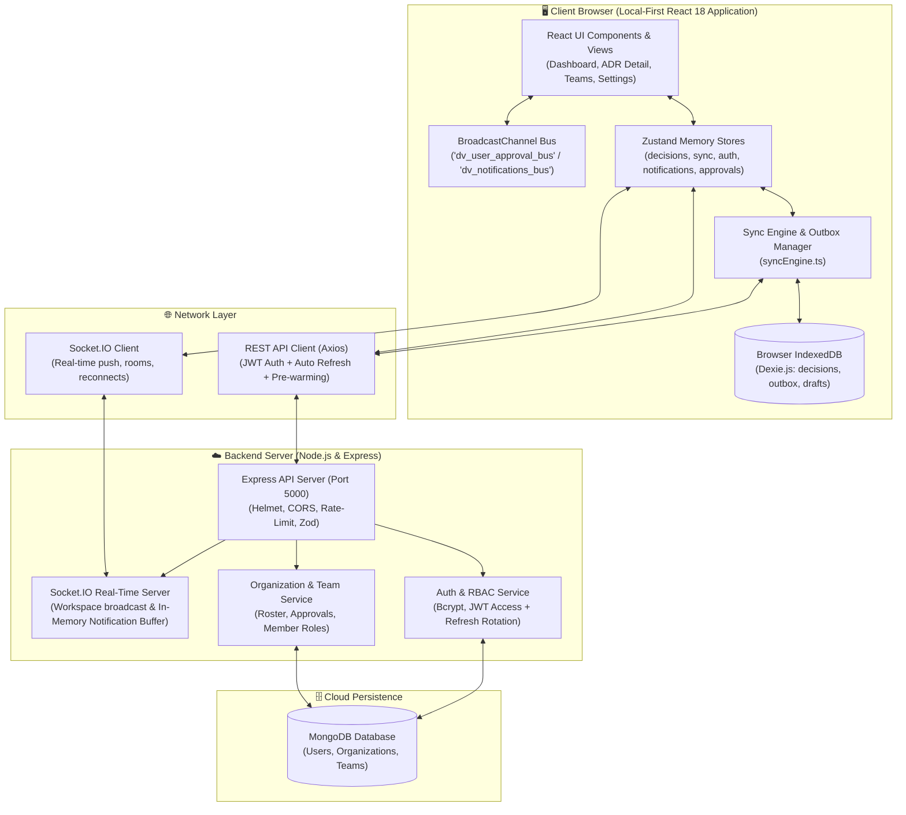
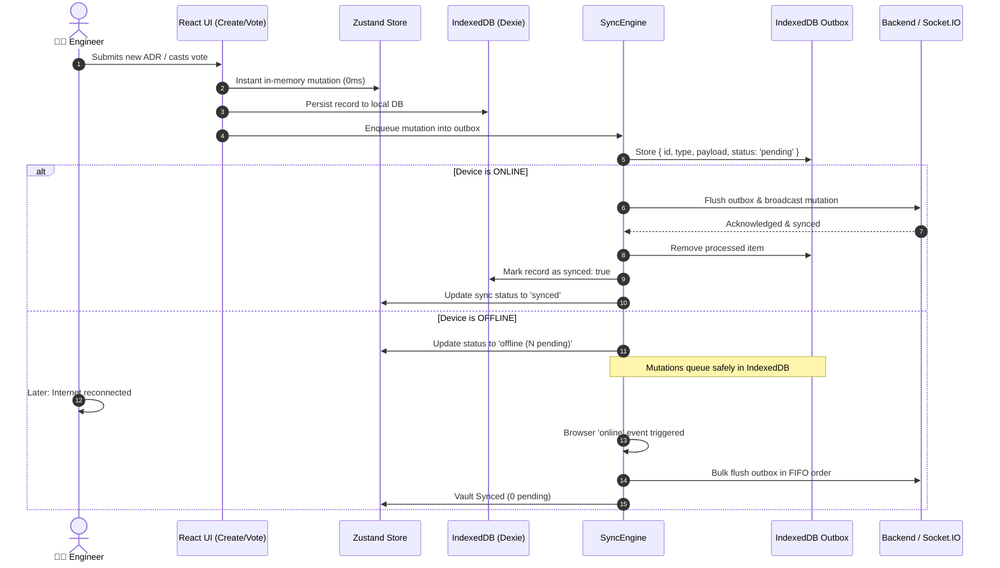
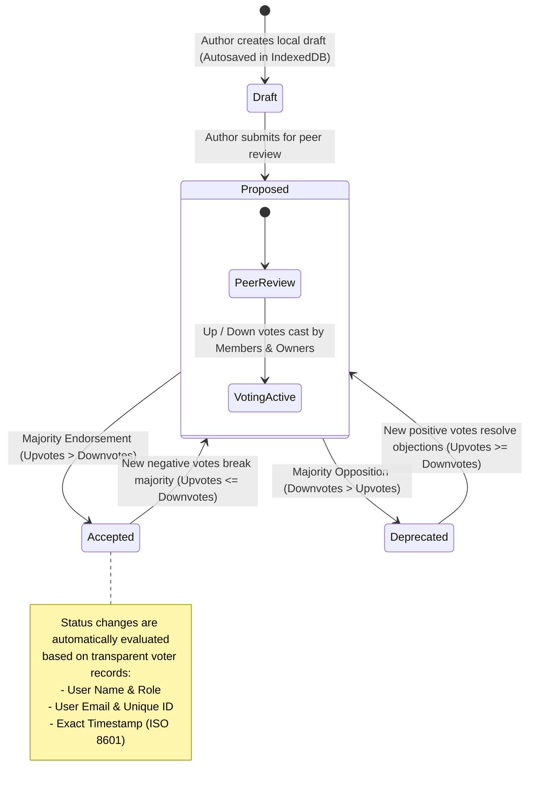
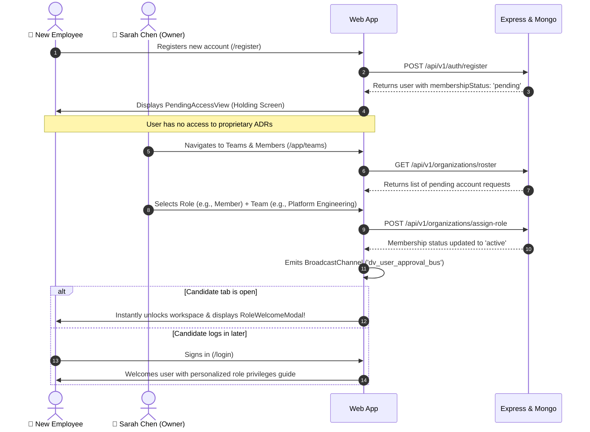

# 🏛️ DecisionVault

> **Local-First Collaborative Architectural Decision Management Platform**  
> *Never lose the "why" behind critical engineering decisions again.*

[](https://www.typescriptlang.org/)
[](https://react.dev/)
[](https://nodejs.org/)
[](https://expressjs.com/)
[](https://www.mongodb.com/)
[](https://dexie.org/)
[](https://socket.io/)
[](https://tailwindcss.com/)
[](https://opensource.org/licenses/MIT)

---

## 📑 Table of Contents

- [🌟 Executive Overview (For Everyone)](#-executive-overview-for-everyone)
  - [The Problem: Architectural Amnesia](#the-problem-architectural-amnesia)
  - [The Solution: What is DecisionVault?](#the-solution-what-is-decisionvault)
  - [The Construction Blueprint Analogy](#the-construction-blueprint-analogy)
  - [User Personas & Real-World Scenarios](#user-personas--real-world-scenarios)
- [✨ Key Features at a Glance](#-key-features-at-a-glance)
- [🏗️ System Architecture & Engineering Blueprint](#️-system-architecture--engineering-blueprint)
  - [High-Level Architecture Diagram](#high-level-architecture-diagram)
  - [Offline-First Local Vault Engine](#offline-first-local-vault-engine)
  - [Real-Time WebSocket & Cross-Tab Bus](#real-time-websocket--cross-tab-bus)
  - [Majority Consensus & Governance State Machine](#majority-consensus--governance-state-machine)
- [🔒 Security & Role-Based Access Control (RBAC)](#-security--role-based-access-control-rbac)
  - [Role Permissions Matrix](#role-permissions-matrix)
  - [User Onboarding & Approval Lifecycle](#user-onboarding--approval-lifecycle)
- [💾 Data Models & Database Schemas](#-data-models--database-schemas)
  - [Client Storage: IndexedDB (Dexie.js)](#client-storage-indexeddb-dexiejs)
  - [Server Storage: MongoDB (Mongoose)](#server-storage-mongodb-mongoose)
- [🔌 API Reference & WebSocket Protocols](#-api-reference--websocket-protocols)
  - [Authentication Endpoints](#authentication-endpoints)
  - [Organization & Team Endpoints](#organization--team-endpoints)
  - [WebSocket Event Reference](#websocket-event-reference)
- [💻 Quick Start & Local Setup](#-quick-start--local-setup)
  - [Prerequisites](#prerequisites)
  - [Installation Steps](#installation-steps)
  - [Demo Accounts (Ready-to-Use)](#demo-accounts-ready-to-use)
- [🚀 Production Deployment](#-production-deployment)
- [📂 Project Directory Tour](#-project-directory-tour)
- [🧪 Testing & Verification](#-testing--verification)
- [🤝 Contributing & License](#-contributing--license)

---

## 🌟 Executive Overview (For Everyone)

> *Can a non-technical manager, product owner, or business executive understand what this software does? **Yes. Absolutely.***

### The Problem: Architectural Amnesia
In almost every software company, teams face a silent, multi-million dollar problem known as **Architectural Amnesia**:
1. An engineer makes a major technical choice (for example: choosing a specific database, changing how passwords are saved, or splitting a system into microservices).
2. The rationale is discussed informally in a Slack thread, a hallway conversation, or an unrecorded Zoom call.
3. Eighteen months later, that engineer changes jobs.
4. A new engineer joins, sees the code, has no idea *why* it was built that way, tries to rewrite it, and accidentally breaks critical production features.

### The Solution: What is DecisionVault?
**DecisionVault** is an enterprise-grade, **local-first platform for Architecture Decision Records (ADRs)**. It acts as an inviolable, searchable digital vault for a team's institutional intelligence.

Whenever an engineer wants to make a substantial technical choice, they document it in DecisionVault:
- **What is the problem?** (Context)
- **What choices were considered?** (Alternatives & trade-offs)
- **What did we decide?** (The core decision)
- **What are the downstream consequences?** (Pros, cons, and operational impacts)
- **Does the team agree?** (Democratic voting & peer consensus)

### The Construction Blueprint Analogy
Imagine building a 50-story skyscraper. 
- You wouldn't let plumbers randomly knock down walls without noting why.
- You wouldn't bury structural change orders in private text messages.
- You have an official **architectural logbook** stamped by lead engineers. When inspectors or future renovations take place 10 years later, every beam, wire, and pipe has a documented reason for existing.

**DecisionVault is that master architectural logbook for software systems.**

### User Personas & Real-World Scenarios

```
+-----------------------------------------------------------------------------------------+
|                                    USER PERSONAS                                        |
+-----------------------------------------------------------------------------------------+
|  👑 Sarah Chen (Lead Architect / Owner)                                                 |
|  • Problem: Needs to govern team standards and review technical proposals.              |
|  • In DecisionVault: Approves new engineers, issues high-priority proposals that trigger|
|    instant workspace-wide review dialogs, and preserves company-wide standards.        |
+-----------------------------------------------------------------------------------------+
|  ⚡ Alex Rivera (Senior Software Engineer)                                               |
|  • Problem: Works on airplanes, trains, or weak Wi-Fi, needs zero-lag tools.            |
|  • In DecisionVault: Creates decisions offline with 0ms latency. The local vault saves   |
|    drafts automatically and syncs to the team the moment internet reconnects.           |
+-----------------------------------------------------------------------------------------+
|  👁️ Jordan Lee (Product Manager / Stakeholder)                                          |
|  • Problem: Needs visibility into technical roadmaps without risking unintended edits.   |
|  • In DecisionVault: Has read-only access to browse, search, and understand why        |
|    certain technical constraints exist, keeping product and engineering aligned.       |
+-----------------------------------------------------------------------------------------+
```

---

## ✨ Key Features at a Glance

| Feature | Description | Business & Engineering Value |
| :--- | :--- | :--- |
| **⚡ Local-First Speed (0ms)** | Reads and writes happen directly against browser IndexedDB. Zero network waiting time. | Instant UI responsiveness; developers love fast tools. |
| **📴 Offline Resilience** | Complete offline capability. Draft ADRs, cast votes, and browse records mid-flight without Wi-Fi. | Zero work loss; engineers remain productive anywhere. |
| **🔄 Background Outbox Sync** | Outbox pattern queues changes locally and reconciles with the cloud upon reconnecting. | Reliable data transmission without duplicate mutations. |
| **🗳️ Majority Consensus** | Dynamic peer voting (Up/Down) with transparent voter attribution and automatic status transition. | Eliminates subjective vetoes; builds democratic alignment. |
| **🔔 Real-Time Collaboration** | Socket.IO pushes instant notifications and dialog alerts across connected teammates. | Eliminates stale tabs and keeps everyone instantly aligned. |
| **🛡️ Enterprise RBAC** | Strict 4-tier role hierarchy: Owner, Admin, Member, and Viewer with self-serve approvals. | Prevents unauthorized modifications and protects audits. |
| **🔍 Instant Command Palette** | `⌘K` / `Ctrl+K` global search across titles, decisions, contexts, tags, and authors. | Find any decision ever made in under 300 milliseconds. |
| **📝 Persistent Auto-Drafts** | Live autosave preserves drafts in local storage as you type. | Never lose a long technical proposal due to an accidental tab close. |
| **🌗 Dual Modern Theme** | Carefully calibrated Light and Dark themes engineered with earthy forest-green accents. | Reduces eye fatigue during long architectural reviews. |

---

## 🏗️ System Architecture & Engineering Blueprint

DecisionVault is designed around the **Local-First Software Principles** (Martin Kleppmann et al.):
1. **The local device is the primary source of truth for the active session.**
2. **Network communication is asynchronous and non-blocking.**
3. **Data is persisted locally in durable client storage (IndexedDB).**
4. **Cloud servers act as multi-client synchronization and consensus relays.**

### High-Level Architecture Diagram



---

### Offline-First Local Vault Engine

The client uses an **Outbox Pattern** built on Dexie.js (IndexedDB). All create, update, and vote actions immediately update both the Zustand in-memory state and the local IndexedDB database, guaranteeing 0ms perceived latency.



---

### Real-Time WebSocket & Cross-Tab Bus

DecisionVault synchronizes state across multiple clients and open tabs simultaneously:
1. **Cross-Tab Communication**: Employs browser `BroadcastChannel` (`dv_notifications_bus` and `dv_user_approval_bus`). If an administrator approves a user in Tab A, Tab B updates immediately without a page reload.
2. **Cross-Teammate WebSocket**: The backend runs a Socket.IO server configured with workspace rooms (`workspace:<orgId>`).
   - When any engineer proposes an ADR, the server broadcasts `notification:new_decision` and `decision:sync_record` to all connected peers.
   - If the proposer is an **Owner**, non-author team members receive an attention-grabbing proposal dialog to review the decision.
   - Reconnecting clients query the `request_recent_notifications` buffer to replay any missed announcements.

---

### Majority Consensus & Governance State Machine

Architecture decisions in DecisionVault follow a democratic, peer-reviewed lifecycle based on verifiable votes:



#### Consensus Logic Rules
1. **Initial State**: Newly submitted ADRs start as `proposed` (or `draft`). They cannot be directly created as `accepted`.
2. **Author Upvote**: The author's endorsement is automatically recorded as an initial Upvote.
3. **Voting Eligibility**:
   - `Owner`, `Admin`, and `Member` roles can vote.
   - `Viewer` / Stakeholder accounts have strictly enforced read-only permissions and **cannot** vote.
4. **Auto-Status Alignment**:
   - $\text{Upvotes} > \text{Downvotes} \implies \textbf{accepted}$
   - $\text{Downvotes} > \text{Upvotes} \implies \textbf{deprecated}$
   - $\text{Upvotes} == \text{Downvotes} \implies \textbf{proposed}$

---

## 🔒 Security & Role-Based Access Control (RBAC)

DecisionVault implements Defense-in-Depth security across both backend controllers and frontend route guards.

### Role Permissions Matrix

| Capability | 👑 Owner | 🛡️ Admin | ⚡ Member (Engineer) | 👁️ Viewer (Stakeholder) |
| :--- | :---: | :---: | :---: | :---: |
| **Browse & Search Decisions** | ✅ | ✅ | ✅ | ✅ |
| **Read Full ADR Context & Trade-offs** | ✅ | ✅ | ✅ | ✅ |
| **Inspect Voter Breakdown & Audits** | ✅ | ✅ | ✅ | ✅ |
| **Draft & Propose New Decisions** | ✅ | ✅ | ✅ | ❌ *(Read-only)* |
| **Vote on Decisions (Up / Down)** | ✅ | ✅ | ✅ | ❌ *(Read-only)* |
| **Broadcast Workspace Dialog Alerts** | ✅ *(Owner Priority)* | ❌ | ❌ | ❌ |
| **Review & Approve New User Signups** | ✅ | ✅ | ❌ | ❌ |
| **Assign Roles (Admin, Member, Viewer)** | ✅ | ❌ | ❌ | ❌ |
| **Manage Teams & Members** | ✅ | ✅ | ❌ | ❌ |
| **Configure Workspace Settings** | ✅ | ✅ | ❌ | ❌ |

---

### User Onboarding & Approval Lifecycle

To safeguard enterprise repositories from unauthorized access, DecisionVault features an administrative holding pattern:



---

## 💾 Data Models & Database Schemas

### Client Storage: IndexedDB (Dexie.js)

Database Name: `DecisionVaultDB`

#### 1. `decisions` Table
- **Primary Key**: `id` (`string`, e.g. `dec-1732261945-a9b1c`)
- **Indexes**: `number`, `status`, `team`, `createdAt`, `updatedAt`
- **Fields**:
  - `number`: Auto-incrementing human-friendly integer (`1`, `2`, `3` $\to$ `ADR-001`, `ADR-002`)
  - `title`: ADR headline
  - `status`: `'proposed' | 'accepted' | 'deprecated' | 'draft'`
  - `team`: Associated engineering team
  - `tags`: Array of categorized strings
  - `context`: Problem statement and business motivation
  - `decision`: Chosen technical path
  - `consequences`: Downstream impacts, trade-offs, and operational risks
  - `alternatives`: Rejected alternatives and justification
  - `author`: `{ id, name, email, role }`
  - `votes`: `{ up: number, down: number, userVote?: 'up' | 'down', voters: VoterRecord[] }`
  - `synced`: `boolean` flag indicating cloud acknowledgment

#### 2. `outbox` Table
- **Primary Key**: `id` (`string`, e.g. `outbox-1732261950-xyz`)
- **Indexes**: `type`, `status`, `createdAt`
- **Fields**:
  - `type`: `'create_decision' | 'update_status' | 'vote_decision' | 'save_draft'`
  - `payload`: Serialized operation data
  - `createdAt`: ISO 8601 string
  - `attempts`: Integer retry count
  - `status`: `'pending' | 'syncing' | 'synced' | 'failed'`

#### 3. `drafts` Table
- **Primary Key**: `id` (e.g. `'new-decision-draft'`)
- **Indexes**: `updatedAt`
- **Fields**: Active title, context, decision, consequences, team, and tag draft inputs.

---

### Server Storage: MongoDB (Mongoose)

#### 1. `User` Schema (`users` collection)
```typescript
{
  name: { type: String, required: true, trim: true, minlength: 2, maxlength: 100 },
  email: { type: String, required: true, unique: true, lowercase: true, trim: true },
  password: { type: String, required: true, select: false }, // Bcrypt hashed (12 rounds)
  avatar: { type: String },
  organizations: [{ type: Schema.Types.ObjectId, ref: 'Organization' }],
  refreshTokens: [{
    token: { type: String, required: true }, // SHA-256 hashed refresh token
    expiresAt: { type: Date, required: true },
    createdAt: { type: Date, default: Date.now }
  }],
  passwordResetToken: { type: String, select: false },
  passwordResetExpires: { type: Date, select: false }
}
```

#### 2. `Organization` Schema (`organizations` collection)
```typescript
{
  name: { type: String, required: true, trim: true },
  slug: { type: String, required: true, unique: true, lowercase: true },
  owner: { type: Schema.Types.ObjectId, ref: 'User', required: true },
  members: [{
    userId: { type: Schema.Types.ObjectId, ref: 'User', required: true },
    role: { type: String, enum: ['owner', 'admin', 'member', 'viewer'], default: 'viewer' },
    status: { type: String, enum: ['active', 'pending'], default: 'active' },
    joinedAt: { type: Date, default: Date.now }
  }]
}
```

#### 3. `Team` Schema (`teams` collection)
```typescript
{
  name: { type: String, required: true, trim: true },
  description: { type: String, trim: true },
  organizationId: { type: Schema.Types.ObjectId, ref: 'Organization', required: true },
  members: [{ type: Schema.Types.ObjectId, ref: 'User' }]
}
```

---

## 🔌 API Reference & WebSocket Protocols

The DecisionVault backend exposes a RESTful API versioned under `/api/v1`.

### Authentication Endpoints

| Method | Endpoint | Description | Auth Required |
| :--- | :--- | :--- | :---: |
| `POST` | `/api/v1/auth/register` | Register a new user account | No |
| `POST` | `/api/v1/auth/login` | Sign in with email and password | No |
| `POST` | `/api/v1/auth/refresh` | Exchange refresh token for new access token | Cookie / Bearer |
| `POST` | `/api/v1/auth/logout` | Invalidate active refresh token | Yes |
| `GET` | `/api/v1/auth/me` | Fetch authenticated user profile & active role | Yes |
| `POST` | `/api/v1/auth/forgot-password` | Request password reset token | No |
| `POST` | `/api/v1/auth/reset-password` | Reset password using one-time token | No |

### Organization & Team Endpoints

| Method | Endpoint | Description | Required Role |
| :--- | :--- | :--- | :---: |
| `GET` | `/api/v1/organizations/roster` | List all active members and pending signups | Member / Viewer |
| `POST` | `/api/v1/organizations/assign-role` | Approve a pending user & assign role/team | Owner |
| `POST` | `/api/v1/organizations/reject-request` | Reject and remove a pending user registration | Owner / Admin |
| `PUT` | `/api/v1/organizations/members/:userId` | Update member role or assigned team | Owner / Admin |
| `DELETE` | `/api/v1/organizations/members/:userId` | Remove a member from the workspace | Owner / Admin |
| `GET` | `/api/v1/organizations/:orgId/teams` | List all teams within an organization | Member / Viewer |
| `POST` | `/api/v1/organizations/:orgId/teams` | Create a new functional team | Admin / Owner |

### WebSocket Event Reference

The real-time layer operates over Socket.IO (transports: `['websocket', 'polling']`).

```
Client                                                  Server
  │                                                        │
  │─── join_workspace { workspaceId: 'acme-corp' } ───────>│  (Joins room)
  │─── request_recent_notifications ──────────────────────>│
  │<── notifications:recent [ ...buffer ] ─────────────────│  (Replays recent notices)
  │                                                        │
  │─── decision:created { payload: DecisionRecord } ──────>│
  │                                                        │─── Broadcasts to room:
  │<── notification:new_decision { WorkspaceNotification }─│   - notification:new_decision
  │<── decision:sync_record { DecisionRecord } ────────────│   - decision:sync_record
```

---

## 💻 Quick Start & Local Setup

### Prerequisites
- **Node.js**: `v18.0.0` or higher (`v20+` recommended)
- **npm**: `v9.0.0` or higher
- **MongoDB**: A running local MongoDB instance (`mongodb://localhost:27017/decisionvault`) OR a free cloud cluster from [MongoDB Atlas](https://www.mongodb.com/atlas).

### Installation Steps

1. **Clone the Repository**:
   ```bash
   git clone https://github.com/Adarsh048/DecisionVault.git
   cd DecisionVault
   ```

2. **Install Root and Workspace Dependencies**:
   ```bash
   npm install
   ```

3. **Configure Environment Variables**:

   **Server Configuration** (`server/.env`):
   ```env
   NODE_ENV=development
   PORT=5000
   MONGODB_URI=mongodb+srv://<username>:<password>@cluster0.mongodb.net/decisionvault?retryWrites=true&w=majority
   JWT_SECRET=decisionvault_jwt_secret_minimum_32_chars_long_dev
   JWT_EXPIRES_IN=15m
   REFRESH_TOKEN_SECRET=decisionvault_refresh_secret_min_32_chars_long_dev
   REFRESH_TOKEN_EXPIRES_IN=7d
   CLIENT_URL=http://localhost:5173
   BCRYPT_ROUNDS=12
   ```

   **Client Configuration** (`client/.env`):
   ```env
   VITE_API_URL=/api/v1
   VITE_APP_NAME=DecisionVault
   ```

4. **Seed the Database with Demo Roles & Teams**:
   ```bash
   npm run seed --workspace=server
   ```

5. **Start Both Server & Client Locally**:
   ```bash
   npm run dev
   ```
   - **Frontend App**: [http://localhost:5173](http://localhost:5173)
   - **Backend API**: [http://localhost:5000](http://localhost:5000)
   - **Health Check**: [http://localhost:5000/api/v1/health](http://localhost:5000/api/v1/health)

---

### Demo Accounts (Ready-to-Use)

The seed script creates three ready-to-test profiles representing each major persona:

| Persona | Role | Email | Password | What You Can Test |
| :--- | :--- | :--- | :--- | :--- |
| **Sarah Chen** | 👑 `Owner` | `admin@decisionvault.io` | `Password123!` | Review pending users, assign roles/teams, propose owner decisions that trigger alerts. |
| **Alex Rivera** | ⚡ `Member` | `alex@decisionvault.io` | `Password123!` | Create ADR proposals, cast Up/Down votes, test offline mode & outbox sync. |
| **Jordan Lee** | 👁️ `Viewer` | `viewer@decisionvault.io` | `Password123!` | Experience read-only exploration, verify voting & proposal locks. |

---

## 🚀 Production Deployment

### 1. Frontend on Vercel
DecisionVault includes a pre-configured `vercel.json` routing configuration:
```json
{
  "buildCommand": "npm run build --workspace=client",
  "outputDirectory": "client/dist",
  "rewrites": [{ "source": "/(.*)", "destination": "/index.html" }]
}
```
1. Import repository into **Vercel**.
2. Set root directory to `.`.
3. Configure Environment Variables:
   - `VITE_API_URL`: Your deployed backend URL (e.g. `https://decisionvault-api.onrender.com/api/v1`).

### 2. Backend on Render / Fly.io / Railway
1. Create a Web Service pointing to the `server` directory.
2. Build Command: `npm install && npm run build --workspace=server`
3. Start Command: `npm run start --workspace=server`
4. Set Environment Variables (`NODE_ENV=production`, `PORT=5000`, `MONGODB_URI`, `JWT_SECRET`, `REFRESH_TOKEN_SECRET`, `CLIENT_URL`).
5. *Built-in Backend Pre-warming*: The client Axios client automatically fires a non-blocking `/health` request upon page load to pre-warm free-tier containers.

---

## 📂 Project Directory Tour

```
DecisionVault/
├── client/                               # Frontend Single Page App (Vite + React)
│   ├── src/
│   │   ├── components/                   # Reusable UI widgets
│   │   │   ├── auth/PendingAccessView.tsx # Holding screen for pending approval users
│   │   │   └── ui/                       # Modals, Logo, Badges, Proposal Alerts
│   │   ├── hooks/                        # Custom React hooks (useAuth, usePermissions)
│   │   ├── layouts/                      # AppLayout (Sidebar + Header), AuthLayout, PublicLayout
│   │   ├── lib/
│   │   │   ├── db.ts                     # Dexie.js IndexedDB schema & entity tables
│   │   │   └── constants.ts              # System-wide enum values and color tokens
│   │   ├── pages/                        # Routable page views
│   │   │   ├── app/                      # Protected pages: Dashboard, Explorer, Detail, Teams
│   │   │   └── public/                   # Public pages: Landing, Login, Register, Forgot Password
│   │   ├── routes/                       # React Router configuration & navigation guards
│   │   ├── services/
│   │   │   ├── api.ts                    # Axios instance, pre-warming & JWT refresh interceptors
│   │   │   ├── syncEngine.ts             # Local-First outbox processor & online/offline listener
│   │   │   └── socketService.ts          # Real-time WebSocket event broadcaster
│   │   ├── store/                        # Zustand stores (decisions, sync, auth, notifications)
│   │   └── types/                        # TypeScript domain contracts (ADR, User, Org, Team)
│   ├── package.json
│   └── vite.config.ts
│
├── server/                               # Backend REST & Real-time Server (Node + Express)
│   ├── src/
│   │   ├── config/                       # Environment variables, constants, and MongoDB connection
│   │   ├── controllers/                  # HTTP route handlers (AuthController, OrganizationController)
│   │   ├── middleware/                   # JWT auth, RBAC authorization, rate limiter, error handlers
│   │   ├── models/                       # Mongoose schemas (User, Organization, Team)
│   │   ├── repositories/                 # Data access layer patterns
│   │   ├── routes/                       # Express router endpoints
│   │   ├── scripts/seed.ts               # Database demo seed script
│   │   ├── services/                     # Business logic layers (AuthService, OrganizationService)
│   │   ├── utils/                        # Logger (Winston), Token helpers, AppError
│   │   ├── validators/                   # Zod request payload schemas
│   │   ├── app.ts                        # Express application factory & security middleware
│   │   └── server.ts                     # HTTP server bootstrap & Socket.IO workspace rooms
│   ├── package.json
│   └── tsconfig.json
│
├── package.json                          # Monorepo workspaces definition
├── vercel.json                           # Vercel deployment routing manifest
└── README.md                             # Complete project documentation
```

---

## 🧪 Testing & Verification

DecisionVault includes automated test suites covering core architectural guarantees:

```bash
# Run client test suite
npm run test --workspace=client

# Run server test suite
npm run test --workspace=server
```

### Verified Scenarios
1. **Notification & Dialog Flow**: Verifies that when an Owner proposes a decision, real-time alerts fire for team members while excluding the author.
2. **Clean Decisions & Voting Flow**: Tests auto-incrementing ADR numbering, transparent voter tracking, read-only prohibition for Viewers, and automatic state transitions (`proposed` $\to$ `accepted` $\to$ `deprecated`).
3. **Role Welcome Flow**: Validates the complete user registration holding state, Owner role approval, cross-tab BroadcastChannel dispatch, and one-time role guide presentation.

---

## 🤝 Contributing & License

Contributions, feedback, and architectural discussions are warmly welcomed!

1. Fork the repository
2. Create your feature branch (`git checkout -b feature/amazing-feature`)
3. Commit your changes (`git commit -m 'feat: add amazing feature'`)
4. Push to the branch (`git push origin feature/amazing-feature`)
5. Open a Pull Request

Distributed under the **MIT License**. See `LICENSE` for more information.

---

<p align="center">
  Built with ❤️ for engineering teams who care about why things are built.
</p>
